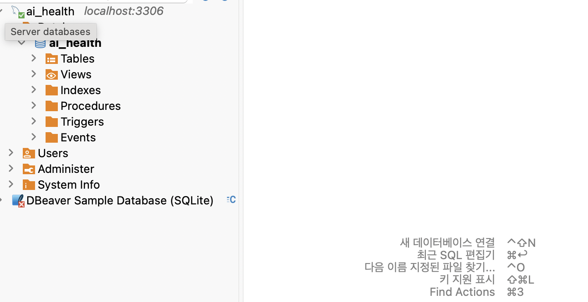
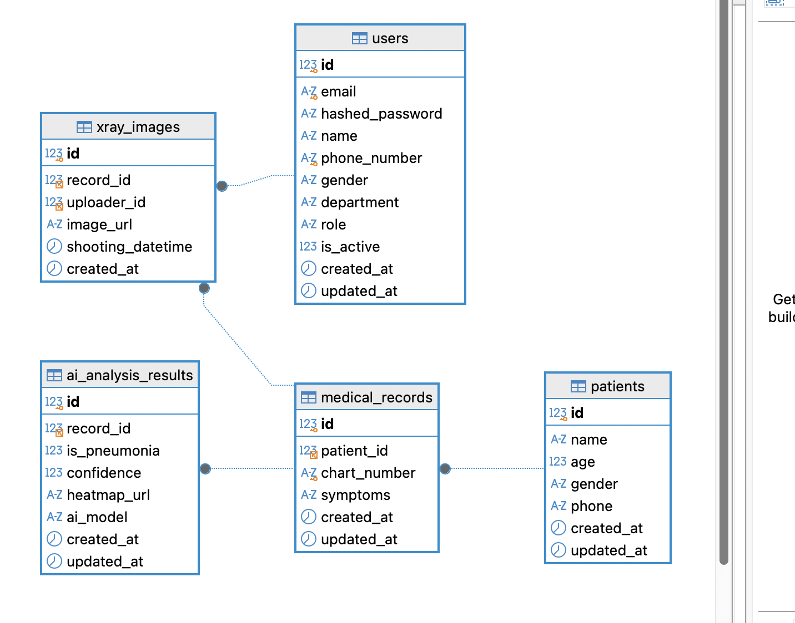
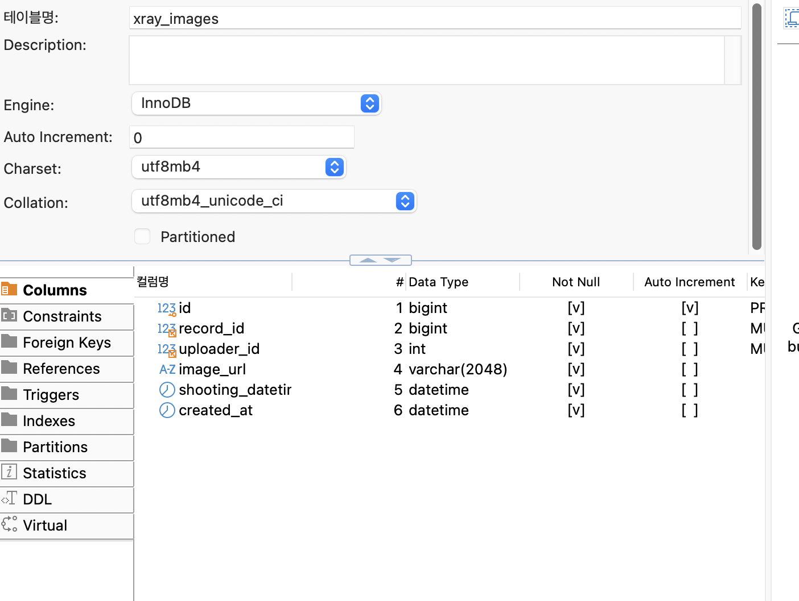

# 3일차 DB 모델 작성 및 마이그레이션

## 1. 개요

ERD를 바탕으로 SQLAlchemy ORM 모델 5개를 작성하고, Alembic으로 마이그레이션을 수행하여 MySQL 데이터베이스에 스키마를 적용했다.

| 항목 | 내용 |
|---|---|
| ORM | SQLAlchemy 2.x (`Mapped`, `mapped_column`) |
| 마이그레이션 | Alembic (`--autogenerate`) |
| 데이터베이스 | MySQL (로컬, Homebrew 설치) |
| 데이터베이스명 | `ai_health` |
| DB Viewer | DBeaver Community |

---

## 2. 작성한 모델

| 테이블 | 모델 파일 | 클래스 | 담당 |
|---|---|---|---|
| `users` | `app/models/user.py` | `User` | 소혜진 |
| `patients` | `app/models/patient.py` | `Patient` | 강선영 |
| `medical_records` | `app/models/medical_record.py` | `MedicalRecord` | 서민서 |
| `xray_images` | `app/models/xray_image.py` | `XrayImage` | 최현영 |
| `ai_analysis_results` | `app/models/ai_analysis_result.py` | `AIAnalysisResult` | 최현영 |

모든 모델은 `app/models/__init__.py`에서 import하여 Alembic이 `Base.metadata`로 인식할 수 있도록 했다.

```python
# app/models/__init__.py
from app.models.ai_analysis_result import AIAnalysisResult
from app.models.medical_record import MedicalRecord
from app.models.patient import Patient
from app.models.user import User
from app.models.xray_image import XrayImage
```

### 테이블 관계

```text
patients ──< medical_records ──< xray_images >── users
                    │
                    └──< ai_analysis_results
```

| 외래키 | 참조 대상 | 관계 |
|---|---|---|
| `medical_records.patient_id` | `patients.id` | 환자 1명 : 진료 기록 N개 |
| `xray_images.record_id` | `medical_records.id` | 진료 기록 1개 : X-Ray 이미지 N장 |
| `xray_images.uploader_id` | `users.id` | 의료진 1명 : X-Ray 이미지 N장 |
| `ai_analysis_results.record_id` | `medical_records.id` | 진료 기록 1개 : AI 판독 결과 N개 |

---

## 3. 데이터베이스 준비

로컬에 Docker가 없어 Homebrew로 MySQL을 설치하고, `.env.example`의 접속 정보에 맞춰 데이터베이스와 계정을 생성했다.

```bash
# MySQL 설치 및 실행
brew install mysql
brew services start mysql

# .env와 동일하게 DB·계정 생성
mysql -u root -e "CREATE DATABASE ai_health CHARACTER SET utf8mb4 COLLATE utf8mb4_unicode_ci;"
mysql -u root -e "CREATE USER 'ozcoding'@'%' IDENTIFIED BY 'pw1234';"
mysql -u root -e "GRANT ALL PRIVILEGES ON ai_health.* TO 'ozcoding'@'%'; FLUSH PRIVILEGES;"

# .env 생성
cp .env.example .env
```

---

## 4. 마이그레이션 수행

### 4-1. 마이그레이션 파일 생성

```bash
uv run alembic revision --autogenerate -m "create initial tables"
```

```text
INFO  [alembic.autogenerate.compare.tables] Detected added table 'patients'
INFO  [alembic.autogenerate.compare.tables] Detected added table 'users'
INFO  [alembic.autogenerate.compare.tables] Detected added table 'medical_records'
INFO  [alembic.autogenerate.compare.tables] Detected added table 'ai_analysis_results'
INFO  [alembic.autogenerate.compare.tables] Detected added table 'xray_images'
  Generating .../alembic/versions/38b51983c575_create_initial_tables.py ...  done
```

### 4-2. 생성된 파일 검토

`alembic/versions/38b51983c575_create_initial_tables.py`를 적용 전에 검토했다.

| 검토 항목 | 결과 |
|---|---|
| 테이블 생성 순서 | `patients` → `users` → `medical_records` → `ai_analysis_results` → `xray_images` (참조당하는 테이블이 먼저 생성됨) |
| 외래키 타입 일치 | `patient_id`·`record_id`(BIGINT) ↔ 각 `id`(BIGINT), `uploader_id`(INT) ↔ `users.id`(INT) |
| 제약조건 | `users.email`, `users.phone_number`, `medical_records.chart_number` UNIQUE |
| `downgrade()` | 생성의 역순으로 테이블 삭제 |

### 4-3. DB에 적용

```bash
uv run alembic upgrade head
```

```text
INFO  [alembic.runtime.migration] Context impl MySQLImpl.
INFO  [alembic.runtime.migration] Will assume non-transactional DDL.
INFO  [alembic.runtime.migration] Running upgrade  -> 38b51983c575, create initial tables
```

### 4-4. 터미널에서 확인

```bash
mysql -u ozcoding -p ai_health -e "SHOW TABLES;"
```

```text
+---------------------+
| Tables_in_ai_health |
+---------------------+
| ai_analysis_results |
| alembic_version     |
| medical_records     |
| patients            |
| users               |
| xray_images         |
+---------------------+
```

`alembic_version` 테이블에는 현재 적용된 마이그레이션 버전(`38b51983c575`)이 기록된다.

---

## 5. DB Viewer(DBeaver) 확인

### 5-1. 데이터베이스 연결

| 항목 | 값 |
|---|---|
| Driver | MySQL (MySQL 8 and later) |
| Host / Port | `localhost` / `3306` |
| Database | `ai_health` |
| Username | `ozcoding` |



### 5-2. ERD 다이어그램

DBeaver의 **View Diagram**으로 생성된 테이블 관계를 확인했다. 설계한 ERD와 동일하게 5개 테이블이 외래키로 연결되어 있다.



### 5-3. 테이블 상세: `xray_images`

컬럼 타입, NOT NULL, Auto Increment, 외래키가 모델과 동일하게 적용된 것을 확인했다.



---

## 6. 진행하며 정리한 내용

| 이슈 | 내용 | 해결 |
|---|---|---|
| 외래키 타입 불일치 | ERD상 `users.id`는 `integer`, `xray_images.uploader_id`는 `bigint` → MySQL은 외래키와 참조 컬럼 타입이 같아야 함 | `uploader_id`를 `Integer`로 맞춤 |
| `TimestampMixin` 기본값 | `default=datetime.now(UTC)`는 서버 시작 시 한 번만 계산되어 모든 행의 `created_at`이 같아짐 | `default=lambda: ...`로 수정 |
| 모델 등록 | `alembic/env.py`가 `from app import models`로 모델을 읽음 | 모든 모델을 `app/models/__init__.py`에 import |
| 마이그레이션 충돌 방지 | 여러 명이 각자 `revision`을 만들면 버전이 갈라짐(multiple heads) | 모델을 모두 Merge한 뒤 한 명이 마이그레이션 수행 |
