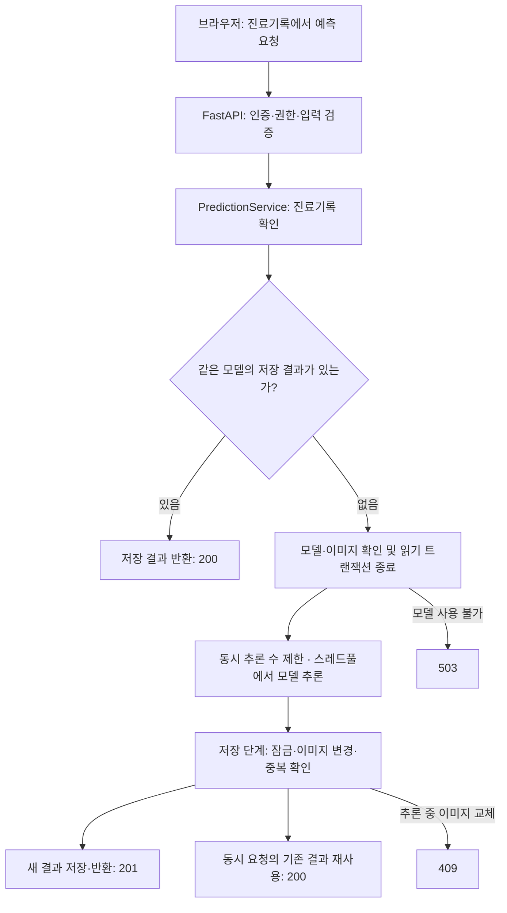

# AI Health · 흉부 X-Ray 폐렴 진단 보조 웹 서비스

> OZ 코딩스쿨 AI 웹 개발 팀 과제 · 2026-10-21 ~ 2026-10-29
> 사내 의료진이 환자와 진료기록을 관리하고, 흉부 X-Ray를 올리면 AI가 폐렴 여부를 예측해 주는 백오피스 서비스입니다.

이 문서는 과제를 마무리하며 **AI 웹 서비스를 만드는 전체 과정을 10단계로 나누어, 우리 팀이 각 단계를 어떻게 진행했는지** 되돌아본 기록입니다. 파이널 프로젝트에서 일정을 세우고 역할을 나눌 때 기준으로 삼기 위해 작성했습니다.

---

## 목차

1. [팀 소개](#팀-소개)
2. [기술 스택](#기술-스택)
3. [전체 일정 한눈에 보기](#전체-일정-한눈에-보기)
4. [프로젝트 과정 총정리](#프로젝트-과정-총정리)
   1. [Team Rule 정의](#1-team-rule-정의)
   2. [사용자 요구사항 정의](#2-사용자-요구사항-정의)
   3. [API 명세서 작성](#3-api-명세서-작성)
   4. [Git & GitHub 브랜치 전략 구성](#4-git--github-브랜치-전략-구성)
   5. [프로젝트 세팅](#5-프로젝트-세팅)
   6. [API 및 AI 워커 코드 작성 후 브랜치 전략을 통한 코드 병합](#6-api-및-ai-워커-코드-작성-후-브랜치-전략을-통한-코드-병합)
   7. [아키텍처 설계 및 적용](#7-아키텍처-설계-및-적용)
   8. [도커 인프라 관련 파일 작성](#8-도커-인프라-관련-파일-작성)
   9. [AWS 배포](#9-aws-배포)
   10. [QA 진행](#10-qa-진행)
5. [파이널 프로젝트에 가져갈 것](#파이널-프로젝트에-가져갈-것)
6. [문서 모음](#문서-모음)

---

## 팀 소개

| 이름 | GitHub | 주요 담당 |
|---|---|---|
| 소혜진 (팀장) | [@thgPwls98](https://github.com/thgPwls98) | 저장소·템플릿 세팅, users 모델, 관리자 API, 진료기록 수정·삭제, AI 예측 모듈, 프론트 연동 |
| 최현영 | [@lomol755](https://github.com/lomol755) | X-Ray·AI 결과 모델, 마이그레이션, 로그인·JWT, 환자 상세·수정·삭제, 진료기록 조회, 폐렴 예측 API, 7일차 통합 문서 |
| 강선영 | [@kangkiwi](https://github.com/kangkiwi) | patients 모델, 회원가입·비밀번호 해싱, 권한 의존성·파일 저장 공통 기능, 진료기록 등록, 예측 결과 목록, 권한·보안 QA |
| 김지영 | [@jiyoungestrella](https://github.com/jiyoungestrella) | Team Rules 초안, 마이페이지 API, 환자 공통 기반·등록·목록, AI 결과 DB 기반, 실패 상황 QA |
| 서민서 | [@smins98](https://github.com/smins98) | medical_records 모델, AI 모델 연결(#41), 실행 화면 문서 검토 |

---

## 기술 스택

| 구분 | 사용 기술 |
|---|---|
| 백엔드 | Python 3.14, FastAPI, Pydantic, SQLAlchemy 2 (async) + asyncmy |
| DB | MySQL 8, Alembic 마이그레이션 |
| 인증 | JWT 액세스 토큰(응답 본문) + 리프레시 토큰(HttpOnly 쿠키), Argon2 비밀번호 해싱 |
| AI | PyTorch, timm · EfficientNet-B0 5-Fold 앙상블 (폐렴 / 정상 이진 분류) |
| 프론트엔드 | 과제 제공 정적 템플릿 (HTML·CSS·Vanilla JS SPA) |
| 패키지 관리 | uv (`pyproject.toml`, `uv.lock`) |
| 테스트 | unittest (Python 테스트 159개), node:test (프론트 테스트 8개), 브라우저 실행 화면 검증 |
| 협업 | GitHub (PR 43개, 머지 37개), Zep·Discord 코어 타임 |

---

## 전체 일정 한눈에 보기

| 일차 | 주제 | 주요 결과물 | 관련 PR |
|---|---|---|---|
| 1일차 | 팀 규칙 · 템플릿 업로드 | `docs/1일차_team_rules.md` | - |
| 2일차 | Git 브랜치 전략 · 연습 API | `docs/2일차_git_branch_전략_추가.md`, 회원 CRUD 연습 API ①~⑤ | #1 ~ #6 |
| 3일차 | 프로젝트 구조 분석 · DB 모델 · 마이그레이션 | `docs/3일차_*.md`, 테이블 5개 모델 | #7 ~ #15 |
| 4일차 | USER API 설계 · 구현 | `docs/4일차_USER_API_설계.md`, 회원·인증·관리자 API 10개 | #16 ~ #23 |
| 5일차 | 환자 · 진료기록 API 설계 · 구현 | `docs/5일차_*.md`, 환자 5개 + 진료기록 6개 API | #24 ~ #33 |
| 6일차 | AI 폐렴 예측 모듈 · 예측 API | `docs/6일차_폐렴예측_API_설계.md`, `worker/model.py`, 예측·결과 목록 API | #34 ~ #41 |
| 7일차 | 프론트 템플릿 API 연결 · 실행 화면 QA | `docs/7일차_앱_실행화면.md` (캡처 51장) | #42, #43 |
| 마무리 | 프로젝트 과정 총정리 | 팀 저장소 루트의 `README.md` | - |

---

## 프로젝트 과정 총정리

각 단계는 **무엇을 했는지 → 어떻게 진행했는지 → 결과물 → 돌아보며(잘된 점 / 아쉬운 점)** 순서로 정리했습니다.

### 1. Team Rule 정의

**무엇을 했나** · 협업 방식과 Git 사용 규칙을 첫날 정했습니다.

**어떻게 진행했나**
- 김지영님이 초안을 쓰고, 나머지 팀원이 각자 수정 의견을 더해 확정했습니다. 소혜진님은 같은 날 저장소에 과제 템플릿을 올렸습니다.
- 정한 규칙

| 구분 | 규칙 |
|---|---|
| 코어 타임 | 15:10 ~ 16:00 Zep(또는 Discord) 모임, 불참은 하루 전 공유 |
| 막힐 때 | 20분 이상 막히면 바로 "SOS" |
| 의사결정 | 의견이 갈리면 10분 토론 후 다수결 |
| 진행 공유 | 매일 코어 타임에 어제 한 일 · 오늘 할 일 · 막힌 부분 공유 |
| 일정 | 모든 작업에 완료 예정일, 지연은 확인 즉시 공유 |
| Git | `main` 직접 push 금지, 한 커밋에 한 작업, 한글 커밋 메시지 (`feat: ...`) |
| 코드 리뷰 | PR은 올린 당일 확인, "~하면 어떨까요?" 제안형 말투, Approve 후 merge |

**결과물** · [`docs/1일차_team_rules.md`](1일차_team_rules.md)

**돌아보며**
- 👍 리뷰 규칙을 정해 둔 덕분에 코드뿐 아니라 문서도 리뷰로 다듬었습니다. 7일차 통합 문서는 엔드포인트 개수, 버전 표기, 권한 표현 등을 서로 검토해 수정했습니다.
- 🤔 규칙 6번의 "Notion이나 GitHub Projects에 일정 기록"은 저장소 문서에서 기록을 확인할 수 없습니다. 파이널에서는 일정을 기록할 곳을 처음에 하나로 정하겠습니다.

### 2. 사용자 요구사항 정의

**무엇을 했나** · 운영진이 제공한 요구사항(REQ / NFR)을 읽고, 일차별 설계 문서 첫 장에서 **요구사항 분석**으로 다시 정리했습니다.

**어떻게 진행했나**
- 제공된 요구사항 ID를 기준으로 API와의 대응 관계를 추적표에 정리했습니다.

| 도메인 | 요구사항 ID | 내용 |
|---|---|---|
| 회원 | REQ-USER-001 ~ 009, NFR-USER-001 ~ 003 | 회원가입, 로그인, 토큰 재발급, 마이페이지, 관리자 승인·권한 변경, 탈퇴 |
| 환자 | REQ-PTNT-001 ~ 005, NFR-PTNT-001 | 환자 등록(의료인만), 목록 검색·필터, 상세, 수정, 삭제 |
| 진료기록 | REQ-MDR-001 ~ 003, NFR-MDR-001 | 진료기록 등록(X-Ray 업로드), 목록, 상세, 이미지 조회 |
| AI 예측 | REQ-PRED-001 ~ 002, NFR-PRED-* | 폐렴 예측, 예측 결과 목록, 모델 성능·처리 시간 기준 |

- 5·6일차 설계 문서에는 **행위자와 권한 분석**(누가 무엇을 할 수 있는가), **데이터 모델 분석**, **프론트엔드 계약 분석**(`static/apis.js`가 기대하는 요청·응답)을 함께 정리했습니다.

**결과물** · 각 설계 문서의 "1. 요구사항 분석" 절

**돌아보며**
- 👍 요구사항 ID로 "API 목록과 요구사항 추적표"를 만들어 빠진 기능을 쉽게 찾았습니다.
- 🤔 이번에는 요구사항을 **제공받아 분석**했습니다. 파이널에서는 사용자 시나리오부터 우리가 직접 써야 하므로, 1일차에 요구사항 정의 시간을 따로 잡겠습니다.

### 3. API 명세서 작성

**무엇을 했나** · 코드를 쓰기 전에 도메인마다 설계 문서(API 명세서)를 먼저 만들었습니다.

**어떻게 진행했나**
- 설계 문서를 PR로 올려 리뷰한 뒤 merge했습니다. (#16, #24, #38) 6일차는 **팀원 5명이 각자 쓴 설계안을 비교해 하나로 통합**했습니다.
- 명세서에 공통으로 넣은 항목: 공통 규칙, 공통 응답 스키마, 오류 코드 표, API 목록과 요구사항 추적, API별 요청·응답·상태코드, 주요 처리 흐름, 결정 사항(D 번호), 테스트 시나리오(T 번호), 팀 기여도

| 일차 | 명세서 | API 수 |
|---|---|---|
| 4일차 | [`USER API 설계`](4일차_USER_API_설계.md) | 회원·인증 · 관리자 10개 |
| 5일차 | [`환자관리 API 설계`](5일차_환자관리_API_설계.md) | 환자 5개 + 진료기록 6개 |
| 6일차 | [`폐렴예측 API 설계`](6일차_폐렴예측_API_설계.md) | 예측 · 결과 목록 (+ 히트맵 선택) |

**돌아보며**
- 👍 설계 단계에서 `static/apis.js`가 기대하는 요청·응답 형식을 미리 맞췄습니다. 그래서 7일차 프론트 연동 PR(#42)에서는 백엔드(`app/`) 코드를 고치지 않았습니다.
- 🤔 설계 문서가 660 ~ 980줄로 길어져 읽는 데 시간이 많이 들었습니다. 파이널에서는 **API 목록 표 + 핵심 결정 사항**을 먼저 보고, 세부 내용은 담당자만 깊게 보는 식으로 나누면 좋겠습니다.

### 4. Git & GitHub 브랜치 전략 구성

**무엇을 했나** · Git Flow와 GitHub Flow를 비교 학습하고, **GitHub Flow 형태의 `main` 중심 작업 흐름**으로 개발했습니다.

**어떻게 진행했나**
- `develop` 없이 **`main` + 작업 브랜치 → PR → 리뷰 → merge** 흐름으로 진행했습니다.
- 브랜치 이름 규칙

| 접두사 | 용도 | 예시 |
|---|---|---|
| `feature/` | 기능 개발 | `feature/signup`, `feature/medical-record-create-v2`, `feature/analysis-list` |
| `fix/` | 버그 · 명세 불일치 수정 | `fix/password-change-logout`, `fix/frontend-api-integration` |
| `docs/` | 문서 | `docs/user-api-spec`, `docs/day7-app-screens` |

- 같은 파일을 여러 명이 고칠 때 충돌을 줄이려고, **공통 기반 PR(모델·스키마·저장소 뼈대)을 먼저 merge하고 기능 PR을 병렬로 올리는** 병합 순서를 정했습니다. ([5일차 작업 계획](5일차_환자관리_API_작업계획.md) 2절)
- 2일차 연습 API는 ① → ②⑤ → ③ → ④ 순서로 merge하며 브랜치 병합과 충돌 해결을 연습했습니다.

**결과물** · [`docs/2일차_git_branch_전략_추가.md`](2일차_git_branch_전략_추가.md), PR 43개 중 37개 merge

**돌아보며**
- 👍 "공통 기반 먼저 → 기능 병렬" 순서로 진행해서 PR이 가장 많았던 10월 27일에도 10개를 하루에 merge했습니다.
- 🤔 GitHub 웹에서 바로 수정하면서 `smins98-patch-*` 같은 기본 이름 브랜치가 생겼고, 일부는 닫혔습니다(#12, #35, #39). 또 같은 기능을 다시 올린 PR(#20 → #21, #25 → #28)이 있었습니다. 파이널에서는 **목적을 알 수 있는 브랜치 이름**을 쓰고, **Draft PR로 먼저 올린 뒤 리뷰 반영은 같은 PR에 커밋**하겠습니다.
- 🤔 규칙을 정한 뒤에도 초반에는 `main`에 직접 올린 커밋이 5건(10/21 ~ 10/23) 있었고, 10월 23일 이후로는 모두 PR로 merge했습니다. 파이널에서는 처음부터 `main` 보호 규칙(Rulesets)으로 막겠습니다.

### 5. 프로젝트 세팅

**무엇을 했나** · 과제 템플릿을 받아 구조를 분석하고, DB 모델과 마이그레이션을 만들었습니다.

**어떻게 진행했나**
- 3일차에 템플릿을 **계층별로 뜯어보는 문서**를 함께 쓰며 `apis / services / repositories / models / schemas / core`의 역할을 맞췄습니다.
- ERD를 바탕으로 테이블 5개를 나눠 맡았습니다.

| 테이블 | 담당 |
|---|---|
| `users` | 소혜진 |
| `patients` | 강선영 |
| `medical_records` | 서민서 |
| `xray_images`, `ai_analysis_results` | 최현영 |

- Alembic으로 초기 마이그레이션을 만들고, DBeaver로 ERD와 컬럼을 확인했습니다. 이후 일차마다 필요한 변경(부서·권한 enum, 환자 테이블, 파일 정리 작업 테이블, 예측 결과 테이블)을 마이그레이션으로 추가했습니다.
- 환경 변수는 `.env`로 분리하고 `.env.example`만 저장소에 올렸습니다. 의존성은 `uv`와 `uv.lock`으로 고정했습니다.

**결과물** · [`docs/3일차_프로젝트_뜯어보기.md`](3일차_프로젝트_뜯어보기.md), [`docs/3일차_db_migration.md`](3일차_db_migration.md), `alembic/versions/`

**돌아보며**
- 👍 공통 구조와 파일별 책임을 문서로 정리해 역할 분담의 기준을 마련했습니다.
- 🤔 **개발 환경 차이**로 막힌 팀원이 있었습니다. `uv.lock`에 고정된 torch 2.11.0의 macOS 패키지는 Apple Silicon(arm64)용뿐이라 Intel Mac에서는 설치할 수 없고, 앱 실행 문서도 macOS·Homebrew 기준입니다. 파이널에서는 **첫날 모두의 OS·칩·Python 버전을 확인하고 같은 실행 환경을 맞추겠습니다.**

### 6. API 및 AI 워커 코드 작성 후 브랜치 전략을 통한 코드 병합

**무엇을 했나** · 일차마다 설계 → 역할 분담 → 브랜치 작업 → PR 리뷰 → merge를 반복했습니다.

**어떻게 진행했나**

| 일차 | 담당 · 구현 | PR |
|---|---|---|
| 4일차 USER | 강선영: 회원가입 + Argon2 해싱 공통 기능 / 최현영: 로그인 · JWT 발급 · 재발급 · 로그아웃 / 소혜진: 관리자 회원 목록 · 권한 변경 / 김지영: 마이페이지 · 비밀번호 변경 · 탈퇴 | #17, #18, #19, #21, #22, #23 |
| 5일차 환자·진료기록 | 김지영: 환자 공통 기반 · 등록 · 목록 / 강선영: 권한 의존성 · 파일 저장 공통 기능 · 진료기록 등록 / 최현영: 환자 상세·수정·삭제(연쇄 삭제 + 파일 정리, 담당 조정 후 구현) · 진료기록 조회 · X-Ray 인증 표시 / 소혜진: 진료기록 수정 · 삭제 | #26 ~ #32 |
| 6일차 AI 예측 | 소혜진: `worker/model.py` 5-Fold 앙상블 추론 / 김지영: 예측 결과 DB 기반 / 강선영: ⑬ 결과 목록 / 최현영: ⑫ 예측(재사용 200 · 신규 201 · 이미지 교체 409 · 동시 추론 제한) / 서민서: 모델 연결(#41, 최현영이 #40에서 lifespan · 지연 로딩 보완) | #34, #36, #37, #40, #41 |
| 7일차 프론트 연동 | 소혜진: 프론트 템플릿 API 연결 · XSS 방지 · 화면 전환 오류 수정 / 전원: 실행 화면 QA → 최현영 통합 | #42, #43 |

- **AI 추론 모듈 구조**: 무거운 모델 코드는 `worker/model.py`로 분리하고, 서버 시작(lifespan) 때 한 번 로드해 재사용합니다. 개발 중에는 `AI_PRELOAD_MODEL=false`로 첫 요청 때 로드합니다. 추론은 스레드풀에서 실행하고 동시 추론 수를 제한했습니다. 요청이 많을 때의 응답 시간은 아직 측정하지 못했습니다.
- **모델 가중치(.pt 5개)는 Git에서 제외**하고 팀원끼리 ZIP으로 전달했습니다.
- 기능별 테스트를 작성하고, 리뷰에서 명세와 다른 부분을 찾아 `fix/user-api-spec-compliance`(#23)처럼 따로 맞췄습니다.

**돌아보며**
- 👍 설계 문서에 담당 · 병합 순서 · 사전 합의 사항(예: `file_storage.py` 함수 이름, `xray_image_url` 형식)을 적어 두어 병렬 작업이 잘 맞물렸습니다.
- 👍 리뷰에서 실제 문제를 잡았습니다. (PR #42에서 삭제된 기존 테스트 4개 복원, #32 리뷰 지적 2건 반영 등)
- 🤔 가중치를 ZIP으로 전달하는 방식은 버전 기록이 남지 않습니다. 파이널에서는 GitHub Releases나 S3 같은 **한 곳에 버전과 함께 보관**하겠습니다.

### 7. 아키텍처 설계 및 적용

**무엇을 했나** · 계층형 구조와 AI 추론 모듈 분리를 코드에 적용했습니다. 추론은 별도 워커 없이 API 서버 프로세스 안에서 실행됩니다.

**어떻게 진행했나**

```text
[브라우저: static/ SPA]
   │  Authorization: Bearer <access token>  /  HttpOnly refresh cookie
   ▼
[FastAPI  app/main.py]
   ├─ apis/          라우터 · 요청/응답 · 권한 의존성 (StaffUser, MedicalStaffUser, AdminUser)
   ├─ services/      비즈니스 로직 · 트랜잭션 · 파일 정리 작업
   ├─ repositories/  DB 쿼리 (SQLAlchemy async)
   ├─ models/ schemas/
   └─ core/          설정 · DB 세션 · JWT · 파일 저장(storage/xray)
   │                         │
   ▼                         ▼
[MySQL 8]            [worker/model.py]
 users · patients     EfficientNet-B0 5-Fold 앙상블
 medical_records      (서버 시작 시 1회 로드, 스레드풀 추론)
 xray_images
 ai_analysis_results
 file_cleanup_jobs
```

**현재 구현의 예측 처리 흐름**



예측 요청은 결과가 나올 때까지 기다리는 동기 방식입니다.

- **역할별 권한**: `pending`(승인 대기) → `staff` → `admin`, 부서(`medical` / `research` / `development`)에 따라 환자 · 진료기록 등록은 의료진 staff와 admin만 가능
- **X-Ray 보안**: 이미지는 공개 폴더가 아닌 `storage/xray`에 저장하고, 토큰을 헤더에 담아 Blob으로 받아 표시
- **파일 정리 작업**: DB 삭제와 파일 삭제가 어긋나지 않도록 `file_cleanup_jobs` 테이블에 기록하고 재처리 스크립트(`scripts/retry_file_cleanup.py`) 제공
- **예측 결과 재사용**: 같은 진료기록 · 같은 모델 버전이면 다시 추론하지 않고 저장된 결과를 반환(200)

**돌아보며**
- 👍 계층을 나눠 둔 덕분에 테스트를 서비스 단위로 쉽게 쓸 수 있었습니다.
- 🤔 지금은 AI 추론이 API 서버 프로세스 안에서 돌기 때문에, 요청이 몰리면 서버 전체가 느려질 수 있습니다. 파이널에서는 **작업 큐(예: Celery · Redis)로 별도 워커 프로세스를 두는 구조**를 검토하겠습니다.

### 8. 도커 인프라 관련 파일 작성

**현재 상태** · ⏳ **진행 예정**

- 템플릿에 `docker-compose.yml`(fastapi + mysql 서비스, healthcheck, 볼륨)이 있고, 6일차에 모델 로딩 시간을 고려해 `start_period: 40s`를 추가했습니다.
- `app/Dockerfile`은 아직 비어 있고, `.dockerignore`도 없습니다. 지금까지는 로컬 MySQL과 `fastapi run`으로 실행했습니다.

**계획**
- `app/Dockerfile` 작성: Python 3.14 + `uv sync`, torch CPU 빌드, 모델 가중치는 이미지에 넣지 않고 볼륨으로 연결
- `docker-compose.yml`에 `.env` 연결, `alembic upgrade head` 실행 순서, `storage/` 볼륨 추가
- 새 환경에서 이미지 빌드 → DB 준비 → 마이그레이션 → API 시작 → 화면·AI 예측까지 실행해 보고 결과 기록

### 9. AWS 배포

**현재 상태** · ⏳ **진행 예정**

**계획**
- EC2에 Docker Compose로 배포하거나, DB는 RDS(MySQL)로 분리
- 운영 설정: `JWT_SECRET_KEY` 환경 변수, `COOKIE_SECURE=true`, `ALLOWED_ORIGINS`에 실제 도메인 지정 (4일차 구현 검증 문서 "남은 배포 검증" 참고)
- X-Ray 이미지와 모델 가중치 보관 위치(EBS 볼륨 또는 S3) 결정
- 배포 후 MySQL 스키마 검사(`scripts/check_user_schema.py`), 브라우저 UI 검증, 부하 검증

### 10. QA 진행

**무엇을 했나** · 자동화 테스트와 실제 브라우저 실행 화면 검증을 함께 했습니다.

**어떻게 진행했나**

| 종류 | 내용 |
|---|---|
| 단위 · 통합 테스트 | `tests/` Python 테스트 159개 (임시 SQLite 통합, 권한, 파일 정리, 예측 서비스, 성능 측정 등) |
| 프론트 테스트 | `tests/test_frontend.cjs` 8개 (토큰 재발급 재시도 상한, 늦게 도착한 응답이 화면을 덮어쓰지 않음 등) |
| 실행 화면 QA | 앱을 띄워 엔드포인트 20개를 브라우저로 직접 확인, 캡처 51장 |

- 7일차에는 **전원이 전체 기능을 직접 실행·테스트한 뒤**, 결과를 공유하고 정상 흐름·실패·권한·보안 등 관점별로 추가 확인하여 통합했습니다. 아래 표는 그중 각자 더 깊게 본 관점입니다.

| 관점 | 담당 | 확인한 내용 |
|---|---|---|
| 정상 흐름 | 최현영 | 회원가입부터 로그아웃까지 엔드포인트별 화면 |
| 실패 · 권한 제한 | 김지영 | AI 양성, 모델 없음 503, 승인 대기 차단, 위양성 사례 |
| 권한 · 입력 검증 · 보안 | 강선영 | 부서별 403, XSS 방어, 이미지가 아닌 파일 415, 차트 번호 중복 409 |
| 연동 · 요청 기록 | 소혜진 | 브라우저 자동화로 정상 흐름, 요청 45건 상태코드 기록, 화면 미연결 API 정리 |
| 문서 검토 | 서민서 | 전체 기능 테스트, 실행 화면 문서 조사·검토 참여 |

- 최종 실행 결과(2026-11-02, `main` `a7cc530`, Python 3.14 · Linux): Python 테스트 153개 통과, 프론트 테스트 8개 통과. `test_worker_model.py` 6개는 torch가 필요해 이번 실행에서 제외했습니다.
- 확인한 상태코드: 200 · 201 · 204 · 401 · 403 · 409 · 415 · 422 · 503 (9종)

**결과물** · [`docs/7일차_앱_실행화면.md`](7일차_앱_실행화면.md)

**QA에서 찾은 개선점**

| 항목 | 현재 | 개선 방향 |
|---|---|---|
| X-Ray가 아닌 이미지 | 업로드 · 예측 모두 통과, 임의로 판정 | 예측 전 X-Ray 여부 판별, 업로드 안내 문구 |
| AI 위양성 | 정상 X-Ray가 Positive 71.2%로 판정, 화면에서 구분 불가 | "진단 보조용" 안내 문구, 경계 구간 표시 |
| 오류 문구 | 503과 500이 같은 문구 | 503은 "AI 기능 점검 중"처럼 구분 |
| 진료기록 수정 · 삭제 | API는 있으나 화면 없음 | 상세 화면에 버튼 추가 |
| 모델 미설치 환경 | torch가 없으면 예측 요청이 503이 아닌 500 | 모델 로딩 단계의 import 오류도 503으로 처리 |

**돌아보며**
- 👍 정상 흐름만이 아니라 **"막혀야 할 때 제대로 막히는가"**를 따로 확인해서, 권한 · 보안 설계가 실제로 동작하는지 확인했습니다.
- 🤔 브라우저로 전체를 확인하는 QA를 **마지막 7일차에 몰아서** 했습니다. 파이널에서는 기능별 화면 확인과 배포 후 재검증을 일정에 넣겠습니다.

**아직 확인하지 못한 것**
- 실제 토큰 만료 대기와 모든 필터·권한 조합은 미확인 범위로 남아 있습니다.
- 이미지 몇 장의 결과로는 위양성 비율을 말할 수 없습니다. 라벨이 있는 평가 데이터로 측정해야 합니다.
- "모든 API 3초 이내"는 설계 목표이고, 모델 로딩을 포함한 전체 API 측정은 하지 못했습니다.
- 선택 기능인 히트맵은 구현하지 않았습니다.

---

## 파이널 프로젝트에 가져갈 것

| 단계 | 이번에 잘한 것 (유지) | 이번에 아쉬운 것 (개선) |
|---|---|---|
| 일정 관리 | 일차별 목표가 분명했음 | GitHub Projects 칸반에 작업 · 기한 · 상태를 실제로 기록 |
| 요구사항 | 요구사항 ID로 API 추적 | 사용자 시나리오와 요구사항을 직접 작성하는 시간 확보 |
| 설계 | 구현 전 명세 합의 | 문서를 "요약 표 + 세부"로 나눠 읽는 부담 줄이기 |
| Git | 공통 기반 PR 먼저 → 기능 PR 병렬 | 목적별 브랜치 이름·Draft PR 활용, `main` 보호 규칙 설정 |
| 환경 | `.env.example`, `uv.lock` | 첫날 Docker / Codespaces로 같은 개발 환경 맞추기 |
| AI | 모델 코드 분리 · 1회 로딩 | 가중치 버전 관리, 별도 워커 프로세스 |
| 인프라 | - | Docker · AWS 배포를 일정 앞쪽에 배치 |
| QA | 정상 · 실패 · 보안 관점 분담 | PR 단위 화면 확인, 배포 후 재검증 |

### 파이널 프로젝트 일정 템플릿 (3주 예시)

| 주차 | 단계 | 완료 기준 |
|---|---|---|
| 1주 초 | 1 Team Rule · 2 요구사항 · 5 프로젝트 세팅 | 규칙 문서, 요구사항 ID 목록, 모두 같은 환경에서 서버 실행 |
| 1주 말 | 3 API 명세 · 4 브랜치 전략 · 7 아키텍처 | 명세서 합의, `main` 보호 설정, 구조도 |
| 2주 | 6 기능 구현 · 병합 + 8 Docker | 기능별 PR merge, `docker compose up`으로 실행 |
| 3주 초 | 9 AWS 배포 | 배포 주소에서 로그인 · 핵심 기능 동작 |
| 3주 말 | 10 QA · 회고 | 실행 화면 문서, 개선점 정리, README |

---

일정은 `Todo → In Progress → Review → Done` 칸반으로 관리하고, 작업마다 **담당자 · 완료 예정일 · 완료 기준**을 적겠습니다. 막힌 작업은 코어 타임에 공유합니다.

---

## 문서 모음

| 일차 | 문서 |
|---|---|
| 1일차 | [Team Rules](1일차_team_rules.md) |
| 2일차 | [Git 브랜치 전략](2일차_git_branch_전략_추가.md) |
| 3일차 | [프로젝트 템플릿 뜯어보기](3일차_프로젝트_뜯어보기.md) · [DB 모델 · 마이그레이션](3일차_db_migration.md) |
| 4일차 | [USER API 설계](4일차_USER_API_설계.md) · [USER API 구현 검증](4일차_USER_API_구현검증.md) |
| 5일차 | [환자 관리 API 설계](5일차_환자관리_API_설계.md) · [작업 계획](5일차_환자관리_API_작업계획.md) |
| 6일차 | [폐렴 예측 API 설계](6일차_폐렴예측_API_설계.md) · [AI 모델 추론 README](../AH_web_development_assignment/worker/README.md) |
| 7일차 | [앱 실행 화면](7일차_앱_실행화면.md) |
| 실행 방법 | [앱 실행 · 마이그레이션 가이드](../AH_web_development_assignment/README.md) |
